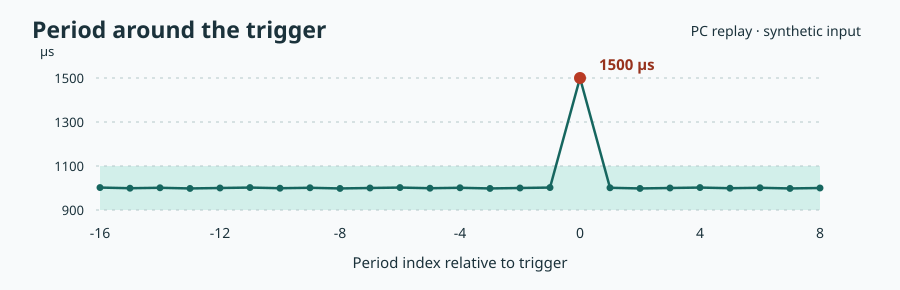

# STM32 脉冲周期异常记录仪

一根稳定输出 1 kHz 的信号线，偶尔有一个周期从 1 ms 变成 1.5 ms。串口每秒打印一次平均频率，很容易错过它。这个小仪器持续记录相邻上升沿之间的时间，遇到越界周期时，留下前后共最多 25 个周期供复盘。



上图来自同一份 C 采集核心的 **PC 回放**。横轴 0 是触发周期，浅绿区域是允许范围。固件已为 STM32F103C8T6 编译、链接并导出 HEX。**实物接线、烧录和串口回环仍待验证。**

## 没有板子，先跑回放

在项目根目录打开终端。Windows 需要 PATH 中有 GCC（例如 MinGW-w64）。

```powershell
.\test-host.ps1
```

脚本编译核心、执行断言、运行回放，并逐行对照样例 CSV。正常时先看到三行 PASS，随后输出序号 −16 到 +8 的数据。Linux 或 macOS 可使用 C11 编译器执行以下命令。

```sh
cc -std=c11 -O2 -Wall -Wextra -Werror -Icore core/recorder.c tests/test_recorder.c -o test-recorder
./test-recorder
cc -std=c11 -O2 -Wall -Wextra -Werror -Icore core/recorder.c host/replay.c -o replay
./replay
```

可以先做个小实验。把 `host/replay.c` 中的 1500 改为 1101，单独编译运行 replay，第 0 行会变成 1101。再改成 1100，程序会以状态 1 退出，因为整个输入流都在允许范围内，没有形成冻结窗口。原样例的完整数据见 [replay.csv](examples/replay.csv)。

## 用一块板演示

准备 STM32F103C8T6 核心板、ST-LINK、3.3 V 电平 USB 转串口模块和跳线。按板子的供电规格供电。板子已有电源时，串口模块只接下表的信号线和地线。

| 核心板引脚 | 接到 | 用途 |
| --- | --- | --- |
| PA6（TIM3_CH1） | 同一块板的 PA0（TIM2_CH1） | 产生方波并送回捕获输入 |
| PA9（USART1_TX） | 串口模块 RX | 导出状态和周期记录 |
| PA10（USART1_RX） | 串口模块 TX | 接收单字符命令 |
| GND | 串口模块 GND | 共地 |

1. 用 ST-LINK 的 SWD 接口连接目标板。首次可直接用 STM32CubeProgrammer 打开 [预编译 HEX](prebuilt/pulse-recorder.hex)，写入后让 MCU 从主 Flash 复位启动。HEX 自带地址。
2. 打开串口终端，选择 **38400、8N1、无流控、ASCII**。复位可见启动提示。发送小写 `s`，稳定后预期返回 `ARMED periods=16`。若长期为 0，检查 PA6 到 PA0 的跳线。若上电瞬间已有异常，待信号稳定后发送 `a`。
3. 发送 `g`，TIM3 把一个周期从 1000 µs 拉长到 1500 µs。等待约 20 ms 再发 `s`，预期为 `FROZEN periods=25`。
4. 发送 `d` 导出 CSV。检查第 0 行约为 1500，两侧约为 1000。重复发送 `d` 应得到相同数据。发送 `a` 重新布防，再次注入即可复现。

直接接外部脉冲时，拔掉 PA6 到 PA0 的跳线，再把 **3.3 V** 信号和共地接到 PA0。PA6 和外部输出应分开。命令 `g` 仅改变板载信号源。检测器在 PA0 的实际边沿上独立工作。

## 从源码生成固件

Windows + Keil MDK 5，使用 Arm Compiler 6 和 Pack Installer 中的 `Keil::STM32F1xx_DFP@2.2.0`、`ARM::CMSIS@5.0.1`。脚本从设备包读取 ST 的启动汇编和寄存器定义。将下例路径改为本机 MDK 根目录。

```powershell
.\build-firmware.ps1 -KeilRoot 'C:\Keil_v5'
```

若器件包使用了独立目录，可追加 `-PackRoot 'C:\path\to\ARM\Packs'`。输出位于 `build/pulse-recorder.hex`，带调试信息的镜像和链接报告也在 `build/`。本次使用 Arm Compiler 6.24，链接报告为 **1796 字节 ROM，1160 字节静态 RAM（含启动文件预留的栈）**。后者是链接分配量，运行时栈峰值仍需测量。

## 采集过程

- **硬件记时。** 芯片复位后保留内部 8 MHz HSI，外设总线分频为 1。TIM2 预分频设为 7，每个计数对应标称 1 µs。上升沿由硬件锁存到 CCR1，中断只读取已锁存的时间。板内信号源和接收端共用时钟，回环适合检查相对周期，绝对精度还要用独立时基测量。
- **捕获偶发异常。** 第一条边沿建立时间基准。布防期间，记录仪保留最近 16 个完整周期。当周期小于 900 µs 或大于 1100 µs 时，标记当前周期并再收 8 个。刚上电就触发也能得到窗口，此时前置样本数可以小于 16。
- **跨越回绕。** TIM2 是 16 位计数器，每 65.536 ms 回绕一次。中断维护软件高位。如果更新和捕获标志同时挂起，锁存值位于低半区时使用新高位，位于高半区时使用旧高位。该判定要求最坏中断响应小于半圈，即 32.768 ms。扩展后的无符号时间戳相减可跨 32 位回绕，前提是相邻边沿间隔小于约 71.6 分钟。
- **保留数据可信度。** 采集中出现 CC1OF 表示硬件锁存值已被后一个边沿覆盖，当前窗口进入 `LOST`。命令 `a` 开启新一轮采集。进入 `FROZEN` 后窗口只读，主循环可在开中断的情况下慢慢打印。
- **测量边界。** 本项目面向 1 kHz 周期异常。它记录上升沿间隔，持续断线时会等待下一个边沿。仅改变占空比而保持周期不变也不会触发。当前版本尚无实测最高输入频率。

## 从哪里读代码

| 文件 | 阅读时可以验证的问题 |
| --- | --- |
| [core/recorder.c](core/recorder.c) | 环形缓冲区已经转过几圈，导出时怎样找到最老的一条？ |
| [firmware/main.c](firmware/main.c) | 哪个寄存器锁存边沿？为什么需要连续两次更新中断才能只拉长一个周期？ |
| [tests/test_recorder.c](tests/test_recorder.c) | 用哪两个捕获值可以区分“刚回绕”和“即将回绕”？ |
| [host/replay.c](host/replay.c) | 改变异常幅度后，触发条件和输出怎样变化？ |

寄存器行为可查 ST 参考手册通用定时器章节中的 input capture、TIMx_SR 和 auto-reload preload 小节。[ST RM0008](https://www.st.com/resource/en/reference_manual/cd00171190.pdf)
